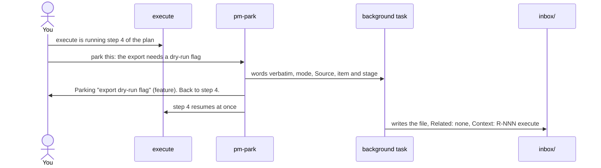
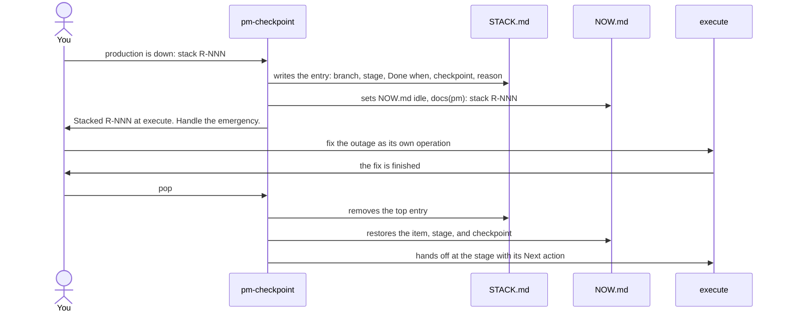
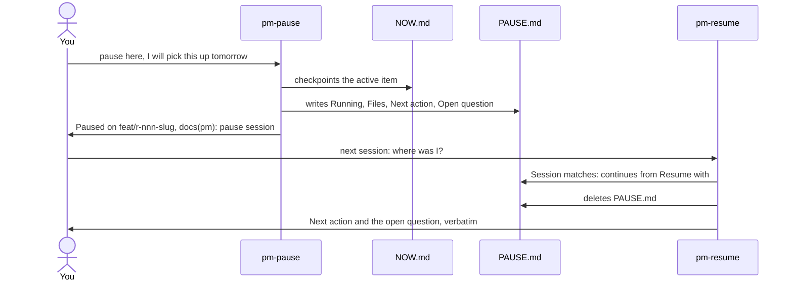

# Non-interruption guarantee

What a PM skill may do while a development workflow is active, and the bounded set of writes and git
changes the skills make at all.

The merged rules make an active workflow own the session. During a
workflow, only `pm-park` and `pm-risk` may write, and only to capture, and
`pm-checkpoint` (`push`, `pop`) may write one stack entry to suspend or
resume the operation when you ask; `pm-rejoin` may
report the position, `pm-help` may explain a skill, `pm-export` and
`pm-docs-site` may check without writing, and `pm-status`, `pm-board`, `pm-roadmap`,
`pm-up-next`, and `pm-risk` may show their read-only view when you ask. None of them may
move, add, insert, or close anything mid-workflow. `pm-revise` may
interrupt to correct built work when you say it is wrong: it records the
scope and pauses the item before anything else runs.
Any other PM skill waits until the workflow finishes; the agent asks
whether to run it after the workflow or pause now.

On purview.dev each diagram below is an interactive LikeC4 sequence: select a step to read its notes.

## Capture mid-workflow

An idea or a risk typed while the agent works is captured in one line, in a background task when the
agent has one, and the step in progress resumes at once.

<!-- purview:likec4 file="../diagrams/pm-skills.c4" view="quickCapture" title="Quick capture" description="Capture an idea or a risk mid-workflow" height="420" -->

[LikeC4 model](../diagrams/pm-skills.c4)
<!-- /purview:likec4 -->

## Suspend for an emergency

`pm-checkpoint` `push` moves the active item onto `planning/STACK.md` so the session is free, and
`pop` restores it at its checkpoint, on the same branch.

<!-- purview:likec4 file="../diagrams/pm-skills.c4" view="suspendResume" title="Suspend and restore" description="push frees the session; pop restores the item at its checkpoint" height="560" -->

[LikeC4 model](../diagrams/pm-skills.c4)
<!-- /purview:likec4 -->

## Pause the session

`pm-pause` writes the position to `planning/PAUSE.md`, with or without an active item, and the next
`pm-resume` continues from it and deletes it.

<!-- purview:likec4 file="../diagrams/pm-skills.c4" view="pauseResume" title="Pause and resume" description="Pause the session and pick it up tomorrow" height="520" -->

[LikeC4 model](../diagrams/pm-skills.c4)
<!-- /purview:likec4 -->

## What the skills write

PM state skills write only to the configured planning directory (default
`planning/`), and never touch specs, plans, or code. A completion record is
the one PM write that happens outside the main worktree: the workflow runs
it at the end of the `execute` stage, and it is committed on the item's
branch so it rides the item's pull request, before CI runs.
The other exception is `pm-docs-site`'s build modes: the site is code, so
they run as a step of the site item's `execute` stage, on
its branch, and leave committing to the workflow.

## What the skills change in git

The git state changes they make are the commit of those planning files and
the branch moves of the feature-branch rules: `pm-next` pulls the latest
planning branch and starts each item on its own feature branch, and every
move pulls first with `--ff-only`. The session stays on its branch when you
ask, during an interruption, and while its pull request is pending. `pm-setup` edits only the managed section in the selected
agent instructions file, plus the `Rules version` line in `config.md`.

Full rules:
[`skills/pm-setup/references/AGENTS-section.md`](../../../skills/pm-setup/references/AGENTS-section.md).
