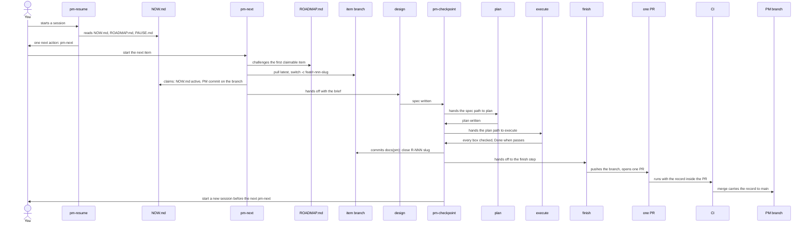
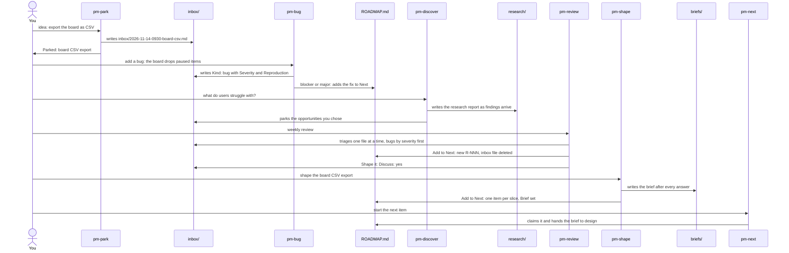
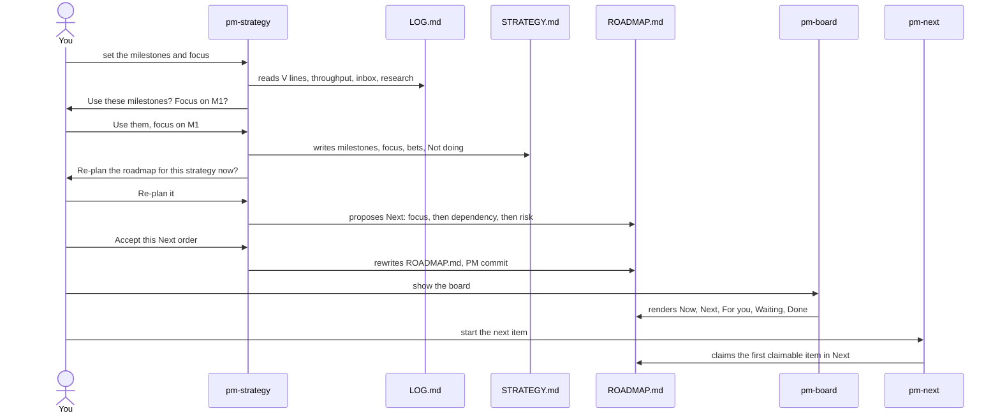
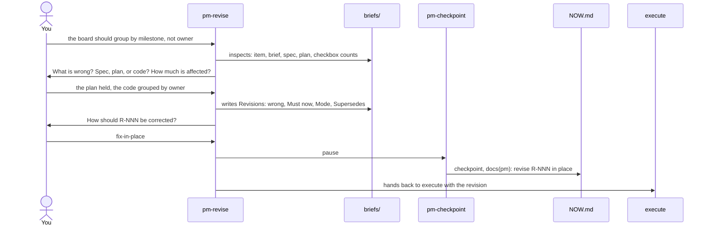
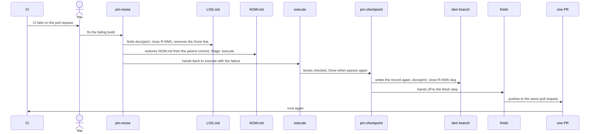
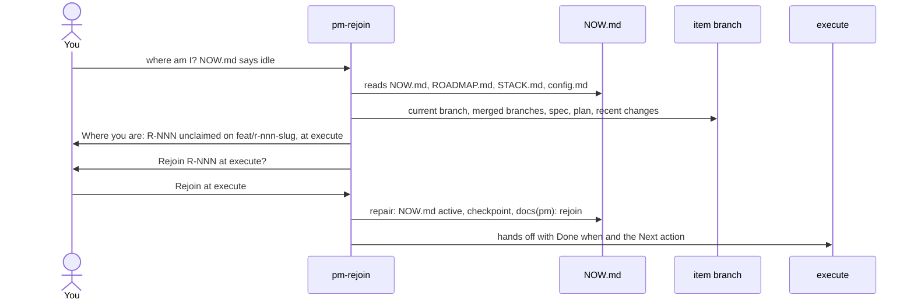

# The loop

How the skills follow one item from claim to merge, which skills run outside that loop, and how ideas,
strategy, corrections, and data flow between them.

On purview.dev each diagram is an interactive LikeC4 sequence: select a step to read what the skill
reads, writes, and commits. Every diagram comes from one model,
[`pm-skills.c4`](../diagrams/pm-skills.c4).

<!-- purview:likec4 file="../diagrams/pm-skills.c4" view="index" title="The loop" description="One item from claim to merge" height="760" -->

[LikeC4 model](../diagrams/pm-skills.c4)
<!-- /purview:likec4 -->

## Outside the loop

| Skill | When it runs |
| -- | -- |
| `pm-park` | Any time, capture only |
| `pm-review` | Weekly |
| `pm-risk` | Capture a risk any time; manage the register when no workflow is active |
| `pm-checkpoint` push/pop | Emergency suspension; the operation resumes at its checkpoint |
| `pm-shape`, `pm-discover`, `pm-strategy` | Think before building, no workflow active |
| `pm-item`, `pm-board`, `pm-roadmap`, `pm-status`, `pm-up-next` | On request, when no workflow is active (their read-only views also mid-workflow) |
| `pm-rejoin` | Any time the position is unclear; it hands back to the stage |
| `pm-bug` | A defect needs the facts a fix needs; it routes to a fix or the roadmap |
| `pm-revise` | Built work is wrong; it may interrupt to correct |
| `pm-export` | A tool needs the plan as JSON, or the export needs checking |
| `pm-docs-site` | Plan the site as an item; its build modes run in execute |

Captures, emergencies, and pauses during a workflow have their own diagrams in
[Non-interruption guarantee](Non-Interruption.md).

## Ideas

An idea reaches the roadmap in steps: `pm-park` (or `pm-discover`, or `pm-bug` for a defect) writes
the inbox, `pm-review` triages it, and `pm-shape` turns it into a brief and roadmap items. A defect can
skip the brief and become an item directly.

<!-- purview:likec4 file="../diagrams/pm-skills.c4" view="ideasFlow" title="Ideas" description="From one line to a roadmap item" height="760" -->

[LikeC4 model](../diagrams/pm-skills.c4)
<!-- /purview:likec4 -->

## Strategy

`pm-strategy` sets milestones and focus, then re-plans the roadmap so Next is ordered by the focus
milestone; `pm-board` renders that order.

<!-- purview:likec4 file="../diagrams/pm-skills.c4" view="strategyFlow" title="Strategy" description="Milestones and focus to an ordered Next" height="640" -->

[LikeC4 model](../diagrams/pm-skills.c4)
<!-- /purview:likec4 -->

## Corrections

`pm-revise` writes the correction to the brief's `## Revisions` (an open item) or opens a revision
item with `Revisits` (a done item), then hands back to the stage skill.

<!-- purview:likec4 file="../diagrams/pm-skills.c4" view="reviseFlow" title="Corrections" description="Built work that is not what you wanted" height="560" -->

[LikeC4 model](../diagrams/pm-skills.c4)
<!-- /purview:likec4 -->

When CI fails, the completion record is already in the pull request but not merged, so it is
reversible and the fix goes on the same pull request.

<!-- purview:likec4 file="../diagrams/pm-skills.c4" view="ciFailure" title="CI fails on the item pull request" description="Fix it on the same pull request, never a new one" height="560" -->

[LikeC4 model](../diagrams/pm-skills.c4)
<!-- /purview:likec4 -->

## Back on the loop

When a session loses its thread, `pm-rejoin` finds the true position from git and the planning files,
and repairs `NOW.md` only after you choose to rejoin.

<!-- purview:likec4 file="../diagrams/pm-skills.c4" view="rejoinFlow" title="Rejoin" description="Back on the loop after the thread is lost" height="520" -->

[LikeC4 model](../diagrams/pm-skills.c4)
<!-- /purview:likec4 -->

## Data

`pm-export` writes `planning/planning.json` from all of the above, and the `pm-docs-site` site renders
it: see [Planning files](../reference/Planning-Files.md#the-export).
