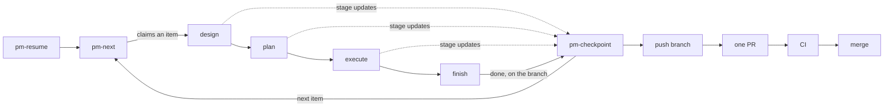

# The loop

How the skills follow one item from claim to merge, which skills run outside that loop, and how ideas,
strategy, corrections, and data flow between them.

<!-- purview:likec4 file="../diagrams/the-loop.c4" view="theLoop" title="The loop" -->

[LikeC4 model](../diagrams/the-loop.c4)
<!-- /purview:likec4 -->

## Outside the loop

| Skill | When it runs |
| -- | -- |
| `pm-park` | Any time, capture only |
| `pm-review` | Weekly |
| `pm-risk` | Capture a risk any time; manage the register when no workflow is active |
| `pm-checkpoint` push/pop | Emergency suspension; the operation resumes at its checkpoint |
| `pm-shape`, `pm-discover`, `pm-strategy` | Think before building, no workflow active |
| `pm-item`, `pm-board`, `pm-roadmap`, `pm-status`, `pm-up-next` | On request, when no workflow is active (their read-only views also mid-workflow) |
| `pm-rejoin` | Any time the position is unclear; it hands back to the stage |
| `pm-bug` | A defect needs the facts a fix needs; it routes to a fix or the roadmap |
| `pm-revise` | Built work is wrong; it may interrupt to correct |
| `pm-export` | A tool needs the plan as JSON, or the export needs checking |
| `pm-docs-site` | Plan the site as an item; its build modes run in execute |

## Flows

Ideas flow: `pm-park` (or `pm-discover`, or `pm-bug` for a defect) -> inbox
-> `pm-shape` -> brief -> roadmap item -> `pm-next`. A defect can skip the
brief and become an item directly. Strategy flows: `pm-strategy` ->
milestones and focus -> ordered Next -> `pm-board`. Corrections flow:
`pm-revise` -> brief `## Revisions` (open item) or a revision item with
`Revisits` (done item) -> the stage skill. Data flows: `pm-export` writes
`planning/planning.json` from all of the above, and the `pm-docs-site`
site renders it.
