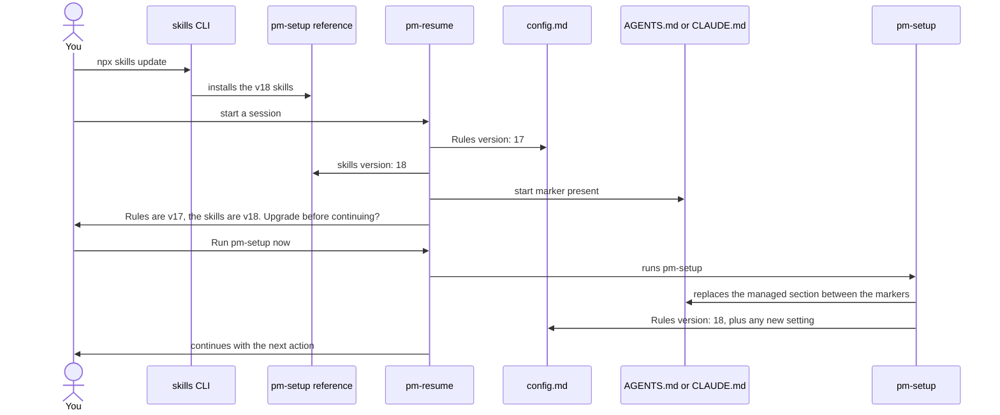

# Upgrading

How to update the installed skills and the rules they share, and how the skills remind you when the two
are out of step.

```bash
npx skills update
```

Then `run pm-setup` again. It replaces only the section between the
markers, which now carry no version, and records the new `Rules version` in
`config.md`; `pm-setup` reports when it is missing. An older marker that
still carries `version=N` is migrated on that run.

You do not have to remember the order. The next `pm-resume`, `pm-rejoin`,
or `pm-next` compares the rules version with the installed skills version
and asks before work resumes; `pm-help` reports the same finding.

<!-- purview:likec4 file="../diagrams/pm-skills.c4" view="upgradeCheck" title="The upgrade check" description="Before work resumes, the rules and the skills are compared" height="600" -->


[LikeC4 model](../diagrams/pm-skills.c4)
<!-- /purview:likec4 -->

The versions in the diagram are an example. On purview.dev, select a step to read what happens when
the versions are equal, the section is missing, or the skills are older than the rules.

What each version changed: [Version history](../reference/Version-History.md).
