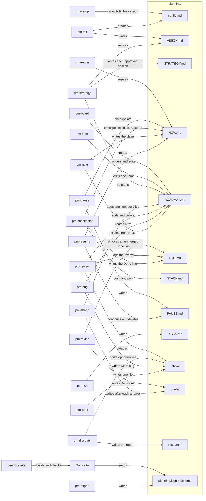
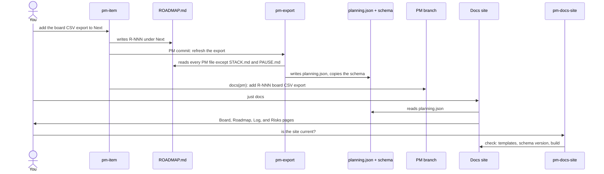

# Planning files

The files `pm-init` creates in the PM root, what each one holds, and the derived export written beside
them.

The paths below use the default PM root; replace `planning/` with the
directory selected during `pm-setup`.

| File | Holds |
| --- | --- |
| `planning/config.md` | Handoffs to workflow skills, limits, commit policy, rules version, last review date |
| `planning/VISION.md` | v1 outcomes, out of scope, constraints |
| `planning/STRATEGY.md` | Focus, milestones, bets, assumptions, not doing, decisions |
| `planning/NOW.md` | The one active item, its checkpoint, decisions, and context |
| `planning/ROADMAP.md` | Next (ordered, maximum 5) and Later, with owner and dependencies |
| `planning/LOG.md` | Done, Dropped, Reviews |
| `planning/STACK.md` | Suspended operations, newest first, with their checkpoints |
| `planning/PAUSE.md` | The paused session's position, written by `pm-pause`; deleted once `pm-resume` continues it |
| `planning/RISKS.md` | The risk register: open, closed, and removed risks with likelihood, impact, and RAG |
| `planning/inbox/` | The parking lot: one file per idea |
| `planning/briefs/` | One shaped idea per file: challenges, ramifications, decision |
| `planning/research/` | One `pm-discover` report per run |

Projects initialised before version 4 keep working. The new files are
created on first use; run `pm-strategy` to create `STRATEGY.md`.

## Which skill writes which file

<!-- purview:likec4 file="../diagrams/pm-skills.c4" view="planningFiles" title="Planning files" description="Which skill writes which file, and what reads the export" height="760" -->

[LikeC4 model](../diagrams/pm-skills.c4)
<!-- /purview:likec4 -->

## The export

`planning/planning.json` and `planning/planning.schema.json` are written by
`pm-export` on first use. They are derived from the files above: never
hand-edit them, and never treat them as the state. Once they exist, every
PM commit refreshes them first (`Export on commit` in `config.md`:
`if present` by default, or `always` or `never`).

<!-- purview:likec4 file="../diagrams/pm-skills.c4" view="exportFlow" title="From a Markdown edit to the docs site" description="Every PM commit refreshes the export, so the site never lags the Markdown" height="600" -->

[LikeC4 model](../diagrams/pm-skills.c4)
<!-- /purview:likec4 -->

What each version added to these files: [Version history](Version-History.md).
