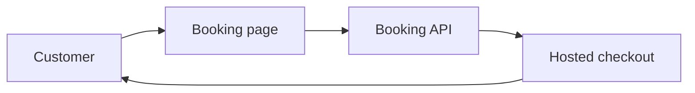
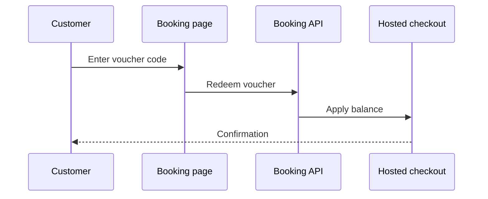

# Diagrams

A booking, from the customer's first click to the confirmed class.

<!-- purview:likec4 file="./diagrams/booking-flow.c4" view="bookingFlow" title="Booking flow" -->

[LikeC4 model](./diagrams/booking-flow.c4)
<!-- /purview:likec4 -->

See the [architecture overview](/architecture/overview/) and
[services](/architecture/services/) pages for the live, interactive views.

A gift voucher redemption, rendered at build time with Mermaid:

