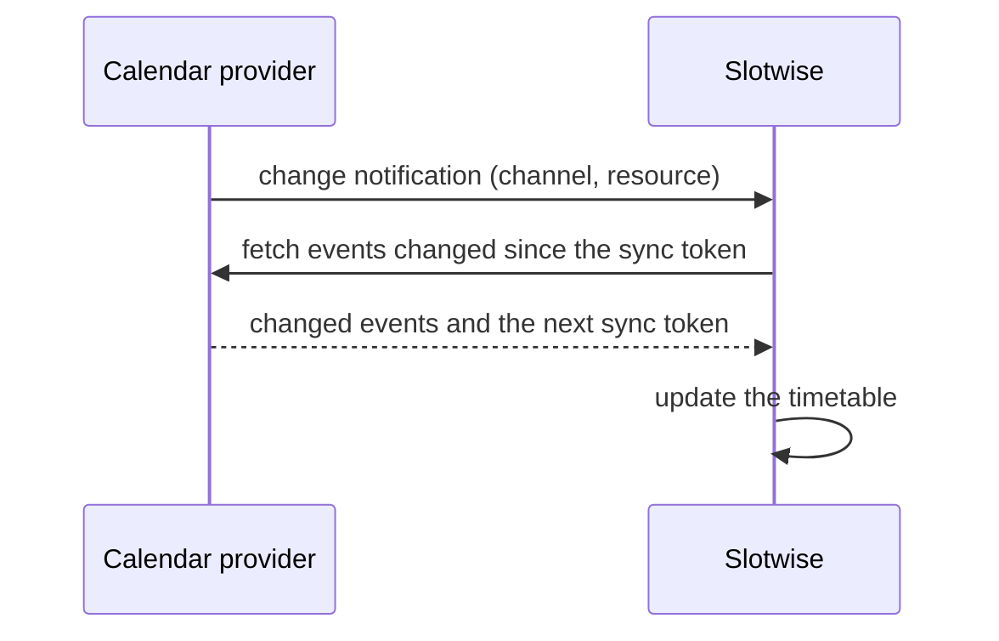

# ADR-004 Sync calendars through webhooks

- Status: proposed
- Date: 2026-11-20
- Category: architecture
- Supersedes: none
- Item: R-012
- Source: none

## Context

R-012 keeps a studio's external calendar and its timetable in step both ways.
Polling every calendar every few minutes would exceed the providers' rate
limits once more than a few dozen studios connect.

## Decision

Subscribe to each provider's change notifications and fetch only the changed
events; poll once a day to repair missed notifications.



A notification carries no event data, only what changed:

```json
{
  "channel": "studio-42-main",
  "resource": "calendars/primary/events",
  "state": "exists"
}
```

## Alternatives

Poll every calendar every five minutes: simpler, but hits rate limits.

## Consequences

- Each provider needs a public webhook endpoint.
