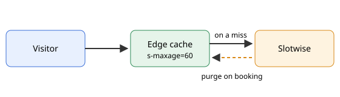

# ADR-006 Cache timetable pages at the edge

- Status: accepted
- Date: 2026-11-04
- Category: operations
- Supersedes: none
- Item: none
- Source: docs/adr/0007-cache-timetable-pages.md

## Context

Imported from the studio app's own ADR folder. A studio shares its public
timetable link on social media, and a busy post sends thousands of visits in
minutes to a page that changes only when a class is booked.

## Decision

Serve public timetable pages from the CDN's edge cache for up to 60 seconds,
and purge a studio's pages when one of its classes is booked or changed, so
R-011 confirmations and the page agree.

## Alternatives

## Consequences

- A booking appears on the public page within one purge, not on the next
  visit's database read.
- `Cache-Control: s-maxage=60` is set on every timetable response.
